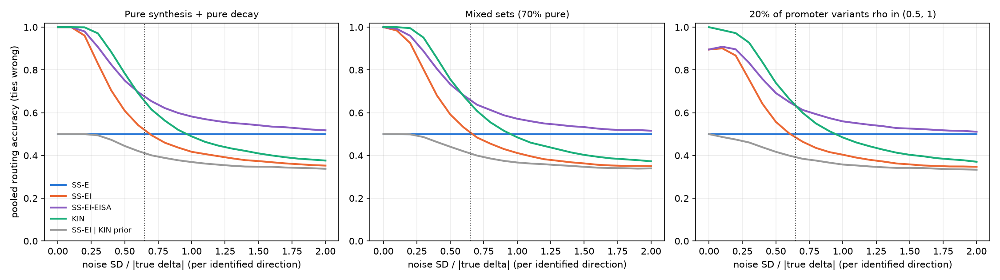

# Sequence-to-kinetics

Steady-state RNA abundance is a ratio of rates. For a gene with synthesis rate alpha, processing
rate beta and decay rate gamma, pre-mRNA sits at alpha/beta and mature mRNA at alpha/gamma, so a
variant that raises transcription and one that stabilizes the mRNA can produce the same change
in exonic coverage. Exon-intron split analysis (EISA; Gaidatzis et al., Nat Biotechnol 2015)
separates the two by assuming processing does not change.

This repository asks which measurements make a regulatory variant's mechanism identifiable as a
change in synthesis, processing or decay. A sequence network outputs a full-covariance Gaussian
posterior over the three log rates of a linear kinetic ODE, whose closed-form solution gives an
exact likelihood for steady-state and metabolic-labeling data from K562. It is trained under
four measurement designs, from exonic steady state alone (SS-E) through exonic and intronic
steady state (SS-EI) to steady state plus labeling time courses (KIN), and each trained model
routes variants with known mechanism from reporter assays: satMutMPRA promoter and enhancer
variants (synthesis) and MapUTR and Su et al. 3'UTR variants (decay). The hypotheses, metrics
and thresholds were fixed in advance in [`PROJECT_PLAN.md`](PROJECT_PLAN.md) and amended once,
before any variant was scored.

The full write-up is in [`docs/REPORT.md`](docs/REPORT.md).

## Summary of results

The kinetic model answers the identifiability question exactly, and its per-gene inference is
calibrated once posteriors have full covariance. A design simulation fixed before scoring
predicted that labeling data would not help route single-mechanism variants, and the trained
models tie as predicted. Labeling data improve held-out gene-level decay prediction, mostly
through rates a covariate regression can also reach. Variant routing fails: the networks learn
whole-segment composition and barely respond to single bases, so their routing does not depend
on the variant. Their amortized posteriors are overconfident and need widening.

- **Identifiability and calibrated inference (H1 holds).** The Jacobian of the observation map
  has rank 1 (SS-E), 2 (SS-EI) and 3 (KIN) at every prior draw; SS-EI identifies a - b and a - c
  and leaves (1, 1, 1) unidentified. Labeling identifies decay for half-lives from 0.19 h to
  13.5 h and narrows 90% intervals for log decay a median 5.7-fold relative to SS-EI on
  simulated genes. Per-gene posteriors pass simulation-based calibration for every rate under
  KIN with a full 3 x 3 covariance; diagonal posteriors fail for every rate (90% coverage 0.54
  to 0.70).
- **Design simulation, fixed before scoring.** It predicted no gain from labeling for
  single-mechanism variants, at zero noise and at the Phase 1 noise structure (KIN - SS-EI
  -0.02); labeling gains only for variants that change two rates or under noise that is
  isotropic across directions. It predicted the KIN and SS-EI tie, and overestimated accuracy
  (predicted 0.71 KIN, 0.72 SS-EI, 0.82 SS-EI-EISA; observed 0.52, 0.52, 0.57). H2 and H3 were
  amended to an equivalence and a non-inferiority test before scoring.
- **Labeling data improve held-out decay prediction.** Out of fold, KIN's log decay rate
  correlates with SLAM-seq decay, an assay no arm trains on, at Spearman 0.47 (seeds 0.45 to
  0.49) on the test chromosomes, against 0.24 for SS-EI. The gain is leak-free and vanishes when
  the labeling data are shuffled within expression deciles (KIN-SHUF 0.28; KIN - KIN-SHUF +0.21
  [0.16, 0.26] on seed 0). Most of it is reachable from gene length and GC covariates regressed
  on the same labeling-derived rates (0.44 out of fold); the convolutional sequence features add
  a partial correlation of 0.23 [0.17, 0.29] (post hoc).
- **Variant routing fails.** On 3,752 significant promoter and enhancer variants and 4,457
  significant 3'UTR variants, pooled accuracy is 0.52 [0.50, 0.56] for KIN, 0.52 [0.51, 0.53]
  for SS-EI, 0.57 [0.55, 0.59] for SS-EI with EISA scoring and 0.58 [0.48, 0.66] for SS-E. H2
  (i) fails (KIN - SS-E -0.06 [-0.16, +0.07]). H2 (ii) meets its equivalence criterion (KIN -
  SS-EI +0.003 [-0.025, +0.044]), but KIN's pooled accuracy spans 0.31 to 0.73 across seeds. H3
  (i) fails, passing on 3'UTR variants and failing on promoter variants. H4 fails for both sets
  (Spearman 0.06 and -0.01). The KIN-SHUF control shows no gain over SS-EI (-0.16 [-0.20,
  -0.12]).
- **Why routing fails.** Each arm routes significant variants, null variants and random
  single-base edits of the same constructs to its known rate at shares within 0.07 of each
  other (KIN-1T promoter excepted), so its accuracy measures a fixed output direction against
  each set's mechanism (post hoc). Median predicted deltas are 7e-6 to 6e-3 in log units
  against measured effects near 0.3, and they do not separate significant from null 3'UTR
  variants (AUROC 0.50 to 0.51). Verified: the scoring path is correct, and the networks move
  up to 0.21 for whole-segment changes and a median 4e-6 to 1.5e-3 for single bases. Inferred:
  gene-level training targets from about 5,300 genes per fold leave the networks insensitive to
  single bases.
- **Amortized posteriors are overconfident.** The networks output posterior SDs at the level of
  a per-gene data posterior on training and held-out genes alike, while their means miss by 0.7
  to 1.0 log units; on 200 held-out genes the KL from the NUTS posterior is 66 nats under KIN,
  against 6 for the prior, and 90% predictive intervals cover 23 to 25% of exonic counts.
  Widening by the covariance of the mean errors brings KIN to 5.6 nats and 0.89 coverage (post
  hoc).




## Figures

| Figure | File |
|---|---|
| Posterior contraction of each log rate against half-life, per design | [`fig1_identifiability.png`](results/figures/fig1_identifiability.png) |
| SBC rank histograms, full-covariance posteriors | [`fig2_sbc_ranks.png`](results/figures/fig2_sbc_ranks.png) (diagonal: [`results/phase1/sbc_ranks_diag.png`](results/phase1/sbc_ranks_diag.png)) |
| Routing accuracy, reporter and endogenous context | [`fig3_routing_accuracy_reporter.png`](results/figures/fig3_routing_accuracy_reporter.png), [`fig3_routing_accuracy_endogenous.png`](results/figures/fig3_routing_accuracy_endogenous.png) |
| Routing margin distributions | [`fig4_routing_margin.png`](results/figures/fig4_routing_margin.png) |
| Amortization gap against NUTS | [`fig5_amortization_gap.png`](results/figures/fig5_amortization_gap.png) |
| Gene-level correlations and predictive coverage | [`fig6_gene_level.png`](results/figures/fig6_gene_level.png) |
| Design simulation | [`fig0_design_simulation.png`](results/figures/fig0_design_simulation.png) |

## Data and models

- **Kinetics, K562.** Whole-cell exonic and intronic counts (GSE264556), TimeLapse-seq fraction
  new at 15 to 120 min (GSE207924), TT-seq 5 min labeling (GSE75792). SLAM-seq decay rates (Wu et
  al., eLife 2019) are held out of every likelihood.
- **Variants.** satMutMPRA (Kircher et al., Nat Commun 2019; MaveDB), MapUTR (Fu et al., Nat
  Commun 2024), Su et al. (eLife 2025). Significant: FDR < 0.05 and |log2 effect| > 0.2.
- **Splits.** 5-fold chromosome cross-validation; each variant is scored only by the fold model
  that held its chromosome out, and 298 3'UTR variants that share a 32-mer with their fold's
  training genes are excluded.
- **Model.** A dilated residual convolutional network over a 2,048 bp promoter segment and a
  12,288 nt transcript segment with codon and splice-junction tracks, attention pooling and gene
  covariates, outputting a full-covariance Gaussian over (a, b, c). It is trained by amortized
  variational inference against each design's Phase 1 empirical-Bayes prior and noise model.
- **Runs.** 55 of the 60 planned runs: SS-E, SS-EI and KIN at three seeds, KIN-SHUF and KIN-1T at
  one seed, each on five folds. KIN-1T seed 1 was cut for time.
- **Sources** with versions and checksums are in [`data/SOURCES.md`](data/SOURCES.md). All runs
  used one Apple M4 Max: 6.2 hours of training and scoring, 6.8 minutes per run
  ([`docs/COMPUTE_LOG.md`](docs/COMPUTE_LOG.md)).

## Limitations

- The networks do not resolve single-nucleotide effects, so the routing test measures each
  arm's variant-independent output direction. A model with real variant sensitivity could route
  differently.
- The gene-level decay gain is mostly reachable from gene covariates, and the posterior
  widening that calibrates the networks is fitted on the genes it is scored on.
- Seed variance in KIN routing (0.31 to 0.73 pooled) exceeds every between-arm difference, and
  the bootstrap intervals, which resample variants, do not include it.
- Variants were assayed in reporters and in cell lines other than K562 (except one element),
  and the MapUTR reporter is approximated by pEGFP-N1.
- Neither variant set labels variants that change two rates, where the design simulation
  predicts a gain from labeling at the Phase 1 noise structure.
- Not run: the lymphoblastoid replication with natural variants (and with it the
  splice-proximal test, H3 (ii)), KIN-1T at a second seed, and the Saluki baseline.
- Six claims were withdrawn or corrected during the work, one operational rule was found
  wanting after a result was seen, and four evaluation errors were fixed post hoc.
  [`docs/REPORT.md`](docs/REPORT.md) lists them with the reasons, and
  [`docs/DECISIONS.md`](docs/DECISIONS.md) records each change when it was made.

## Reproducing

```bash
make setup     # Python 3.12 virtual environment with uv (dev and NUTS extras)
make data      # download every source and build the gene, K562 and variant tables
make g0        # Gate G0
make phase1    # per-gene fits, identifiability, SBC and Gate G1 (CPU, about 5 min)
make inputs    # encode network inputs and scan for sequence-overlap leakage
make train ARM=KIN SEED=0 FOLD=fold0   # one run, about 7 min on MPS
make grid      # every run in configs/phase2_queue.txt, one job at a time
make nuts      # NUTS reference posteriors for the amortization gap (CPU, about 6 min)
make eval      # motif baseline, routing metrics and hypotheses, gene-level metrics, post hoc diagnostics
make report    # figures
make test      # test suite, CPU only
```

`python -m sk.eval.design_sim` reruns the pre-scoring design simulation (9 s on CPU), and
`python -m sk.eval.tables` writes [`results/phase3/tables.md`](results/phase3/tables.md).

## Repository layout

```
src/sk/
  data/       downloads, gene models, K562 tables, variant sets, splits, leakage scan
  kinetics/   closed-form ODE solutions, likelihoods, Fisher information, simulation
  model/      network inputs and reporter constructs, sequence network, arm priors
  infer/      per-gene variational fits, amortized ELBO, NUTS reference, SBC
  eval/       gates, Phase 1, design simulation, scoring, routing metrics, gene metrics, figures
  train.py    one arm, seed and fold
configs/      splits.yaml, phase1.yaml, base.yaml, phase2_queue.txt
docs/         REPORT.md, DECISIONS.md, DESIGN_CHECK.md, COMPUTE_LOG.md
data/         SOURCES.md and recorded checksums (raw and processed data are not committed)
results/      metrics, tables, hypothesis verdicts and figures
scripts/      sequential grid runner
tests/
```

## License

MIT. See [`LICENSE`](LICENSE).
