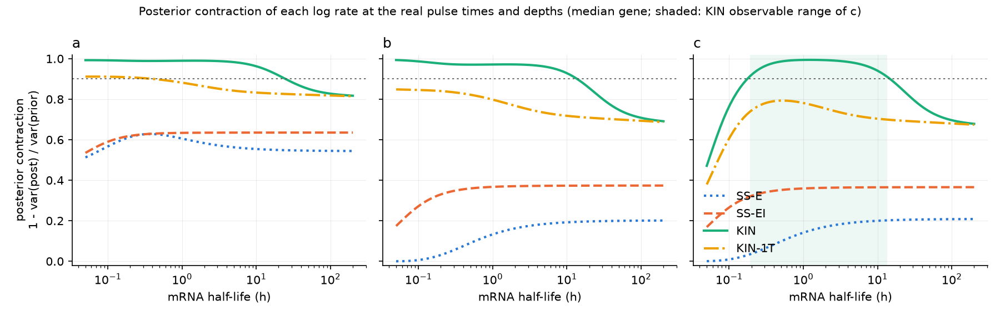
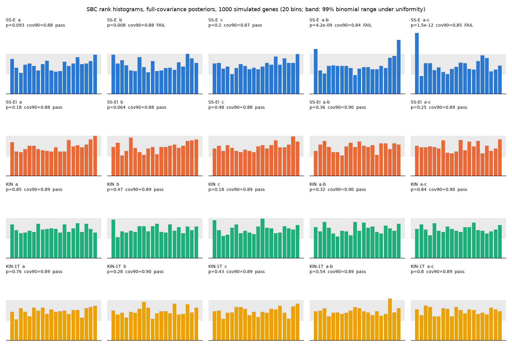
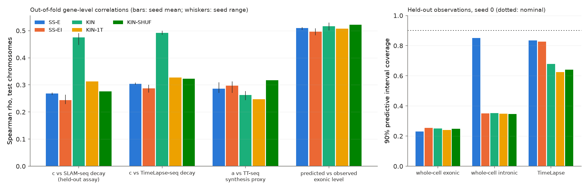
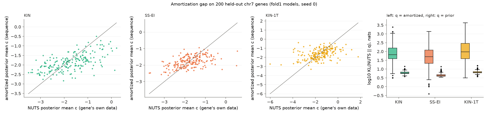
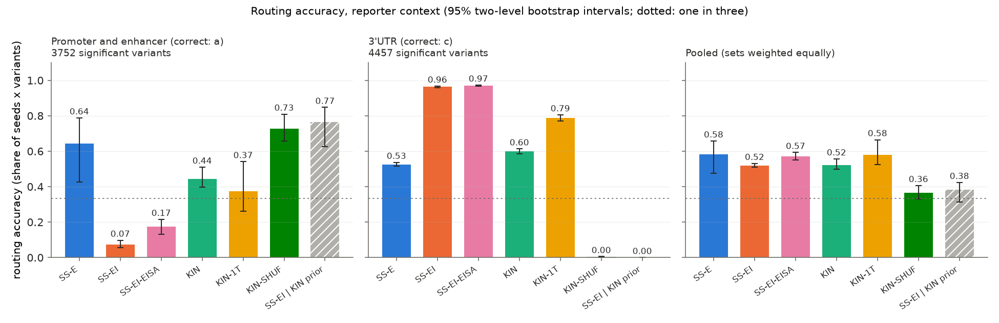
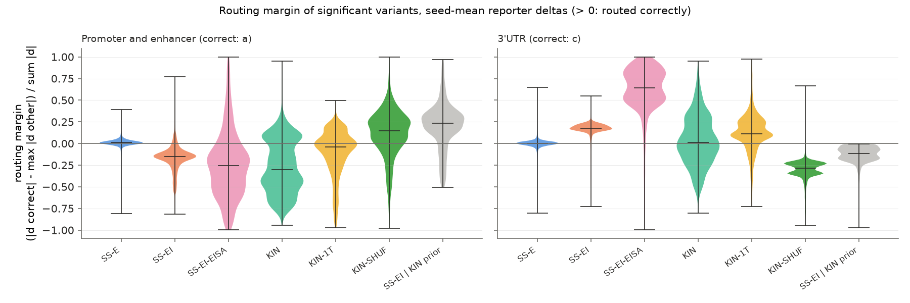

# Sequence-to-kinetics: which measurements make regulatory variant effects identifiable as synthesis, processing or decay?

Report on the experiments pre-registered in [`PROJECT_PLAN.md`](../PROJECT_PLAN.md). Every
change to the plan is in [`DECISIONS.md`](DECISIONS.md) with its date and whether it followed a
seen result, and every run is in [`COMPUTE_LOG.md`](COMPUTE_LOG.md). The numbers below come from
the committed files in [`results/`](../results/). `make eval` and `make report` regenerate them
from the trained runs; [`results/phase3/tables.md`](../results/phase3/tables.md) holds every
table in full.

## 1. Conclusion

Which measurements identify a variant's mechanism is answered exactly by the model, and the
sequence networks trained here cannot use the answer on real variants.

- **Identifiability (verified, H1 holds).** Exonic steady state identifies one combination of
  log rates, exonic plus intronic steady state two (a - b and a - c), and adding metabolic
  labeling identifies all three for half-lives from 0.19 h to 13.5 h. On simulated genes, 90%
  intervals for log decay are a median 5.7 times narrower with labeling than with steady state
  alone, and per-gene posteriors are calibrated once they have full covariance.
- **The design simulation, run before any variant was scored, predicted no gain from labeling
  for single-mechanism variants** at zero noise and at the Phase 1 noise structure (KIN - SS-EI
  -0.02). Exonic plus intronic steady state already separates a pure synthesis change from a
  pure decay change, so labeling gains only for variants that change two rates or when
  estimation noise is isotropic across directions. The simulation predicted the KIN and SS-EI
  tie; its pooled accuracies (KIN 0.71, SS-EI 0.72, SS-EI-EISA 0.82) are well above those
  observed (0.52, 0.52, 0.57). H2 and H3 were amended before scoring.
- **Labeling data lift held-out decay prediction.** Out of fold, the KIN network's log decay
  rate correlates with held-out SLAM-seq decay at Spearman 0.47 on the test chromosomes (seed
  range 0.45 to 0.49), against 0.24 for SS-EI and 0.28 for KIN-SHUF, whose labeling data are
  shuffled within expression deciles. The gain is leak-free. Most of it is reachable from a
  regression of the same labeling-derived rates on gene length and GC covariates (0.44); the
  convolutional sequence features add a partial correlation of 0.23 (post hoc).
- **No arm routes real variants by mechanism.** Median predicted single-variant deltas are 7e-6
  to 6e-3 in log units (at most 3.4e-3 in the H2 arms) against measured effects of about 0.3.
  They explain less than 0.1% of the measured effects' squared norm, do not separate significant
  from null 3'UTR variants (AUROC 0.50 to 0.51), and do not track effect size (H4 fails:
  Spearman 0.06 [-0.08, 0.13] and -0.01 [-0.06, 0.04]). Each arm routes significant variants,
  null variants and random single-base edits of the same constructs at nearly the same shares
  (post hoc, section 6.4), so its accuracy on a set measures a fixed output direction against
  that set's mechanism.
- **H2 (i) fails** (KIN - SS-E -0.06 [-0.16, +0.07]). **H2 (ii) meets the equivalence
  criterion** (KIN - SS-EI +0.003 [-0.025, +0.044]), but KIN's pooled accuracy ranges from 0.31
  to 0.73 across its three seeds, a spread the variant bootstrap does not include, so the
  equivalence is fragile. **H3 (i) fails**: it passes on the 3'UTR set (SS-EI-EISA - KIN +0.37)
  and fails on the promoter set (-0.27), and both results reflect output directions that do not
  depend on the variant. **H3 (ii)** is untested. **The KIN-SHUF control**, paired on its one
  seed, routes worse than SS-EI (-0.16 [-0.20, -0.12]), which does not trigger its extra seeds.
- **Amortized posteriors are overconfident.** On 200 held-out genes, the KL divergence from the
  per-gene NUTS posterior to the amortized posterior has median 66 nats under KIN, against 6 nats to
  the prior. The network outputs data-level posterior SDs (0.09 to 0.17) on training and held-out
  genes alike, while its means miss by 0.7 to 1.0 log units, so its posteriors are overconfident
  everywhere: 90% predictive intervals cover 23 to 25% of whole-cell exonic counts in every arm.
  Widening them by the covariance of the mean errors calibrates them (post hoc; KL 5.6 nats,
  coverage 0.89 under KIN).

The identifiability analysis answers which measurements separate the mechanisms for exact
estimates. The real-variant test is inconclusive about mechanism, because the trained networks
barely respond to single-nucleotide changes.

## 2. Data

- **Kinetic measurements, K562.**
  - Whole-cell steady state: exonic and intronic counts in four unperturbed replicates
    (GSE264556).
  - Labeling time course: TimeLapse-seq fraction new at 4sU pulses of 15, 30, 60 and 120 min,
    two replicates, with the 0 min sample as each gene's background (GSE207924).
  - TT-seq: 5 min 4sU labeled and total RNA in 200 bp bins, summed over each gene's exonic and
    intronic bins (GSE75792).
  - Held out of every likelihood: SLAM-seq decay rates (Wu et al., eLife 2019).
- **Gate G0.** 7,207 genes have exonic and intronic counts above 10 in all four replicates and
  fraction-new data at two or more pulses (threshold 5,000). TimeLapse-seq and SLAM-seq
  half-lives agree at Spearman rho 0.611 over 8,738 genes (threshold 0.5).
- **Synthesis-side variants.** satMutMPRA saturation mutagenesis (Kircher et al., Nat Commun
  2019) of 15 human promoters and enhancers assayed in seven cell lines, from MaveDB. The plan's
  primary source (the Agarwal et al. 2025 lentiMPRA) has no measured allelic table.
- **Decay-side variants.** MapUTR rare 3'UTR variants (Fu et al., Nat Commun 2024; HEK293 and
  HeLa) and Su et al. (eLife 2025) disease-database UTR variants (HEK293T and SH-SY5Y).
- **Significance**, fixed before scoring: FDR < 0.05 and |log2 effect| > 0.2. A variant is null
  when FDR > 0.5 in every measurement of it.
- **Splits.** Every promoter and enhancer element lies on a primary training chromosome, so
  variants are scored under 5-fold chromosome cross-validation: each fold model scores only the
  chromosomes it held out. Gate G2 passes with 3,752 significant promoter and enhancer variants
  and 4,521 significant 3'UTR variants scoreable (threshold 150 each). Routing counts 3'UTR
  units as a variant in one reporter insert: 4,523 significant units, of which 66 are excluded
  for leakage, leave the 4,457 of section 6.4.
- **Leakage.** No satMutMPRA element shares a 32-mer with its fold's training genes. 298 3'UTR
  variants share a 32-mer containing the variant with a training gene of their scoring fold and
  are excluded from it (`results/phase2/leakage.json`).

## 3. Identifiability (Phase 1, no sequence model)

The model is the linear two-compartment ODE du/dt = alpha - beta u, dm/dt = beta u - gamma m,
with log rates a, b, c. Steady state fixes a - b (introns) and a - c (exons, about 90% mature
signal). Labeled fractions depend on b and c only, so a labeling pulse sets an absolute time
scale. The closed-form solution gives an exact likelihood for every assay.

- **Jacobian rank** of each design's observation map at 100 prior draws: SS-E 1, SS-EI 2, KIN 3,
  KIN-1T 3, in every draw. SS-EI leaves (1, 1, 1) unidentified.
- **Observable range.** KIN identifies c (posterior variance <= 10% of prior variance, median
  gene) for half-lives from 0.19 h to 13.5 h. SS-E, SS-EI and KIN-1T reach no such range; their
  largest contraction of c is 0.21, 0.37 and 0.79.
- **H1 holds.** On 1,000 genes simulated from the fitted prior and noise model, the median ratio
  of 90% interval widths of c, SS-EI over KIN, is 5.7 (quartiles 3.7, 9.1) for the 931 genes in
  the KIN range (threshold 3). Under SS-EI the posterior SD of (a + b + c)/3 is a median 0.905 of
  its prior SD (threshold 0.8).
- **SBC (Gate G1) passes with full-covariance posteriors.** Chi-square p and 90% coverage: KIN a
  0.85 / 0.888, b 0.47 / 0.886, c 0.18 / 0.885; SS-EI a - b 0.36 / 0.896, a - c 0.25 / 0.892.
  Diagonal posteriors fail for every rate (KIN 90% coverage 0.54, 0.62, 0.70): the SS designs pin
  a - b and a - c and leave a ridge along (1, 1, 1), and under KIN a is identified only through
  a - c and c, so the posteriors are strongly correlated and a factorized Gaussian puts its
  variance across the ridge. SS-E fails SBC for b, a - b and a - c even with full covariance,
  because its exonic count fixes log(exp(a - b) + exp(a - c)), a curved ridge.

## 4. Design simulation and the H2 and H3 amendment

Before any network was trained, `src/sk/eval/design_sim.py` checked whether the routing test
could be passed or failed by construction ([`DESIGN_CHECK.md`](DESIGN_CHECK.md)). Along a
direction the likelihood does not constrain, the ELBO-optimal posterior mean is the prior
conditional mean given the constrained components, so an SS arm's predicted deltas are a fixed
linear map of its identified deltas. Under the adopted SS prior, which makes the unidentified
direction independent of the identified ones, the SS-EI map is the orthogonal projection that
removes (1, 1, 1). It routes every pure single-rate change correctly, with margin 0.25.

The simulation drew 4,000 genes from the KIN prior and applied each arm's map with estimation
noise, either isotropic (SD r x |delta|) or at the Phase 1 per-gene Fisher information with
MPRA effect sizes:

- **SS-E routes every variant to a** at any noise level. The exonic signal constrains
  (1, -0.10, -0.90), and the prior map sends every delta to a multiple of (1, -0.13, -0.87). Its
  pooled accuracy is 0.5 by construction, so the SS-E clause of H2 reduces to KIN pooled
  accuracy >= 0.65.
- **SS-EI matches KIN at zero noise** on variants with one mechanism (both 1.00): exonic plus
  intronic steady state already separates a pure synthesis change from a pure decay change. KIN
  gains only on variants that change two rates at once, such as synthesis with a processing
  change at least half its size, and neither MPRA set labels such variants.
- **With noise, the sign of KIN - SS-EI is set by the noise structure.** At the Phase 1 operating
  point the allele-difference noise is 0.37 of the median effect per steady-state direction for
  both arms and 0.99 along (1, 1, 1) for KIN, and KIN - SS-EI pooled is -0.02. The original
  +0.05 clause holds only when the steady-state noise is at least 0.25 and the noise along
  (1, 1, 1) is no larger.
- **SS-EI-EISA** (delta b = 0 imposed at scoring) has the highest pooled accuracy at the Phase 1
  operating point on single-mechanism sets: 0.82 against 0.71 for KIN.

H2 and H3 were amended on this basis before any variant was scored (DECISIONS, 2026-10-25).
H2 (i) is unchanged: KIN - SS-E >= 0.15 with the paired interval above 0. H2 (ii) became an
equivalence test: the paired 95% interval of KIN - SS-EI inside [-0.05, 0.05]. H3 (i) became a
non-inferiority test: SS-EI-EISA >= KIN - 0.05 on each set. An error decomposition into the
steady-state plane and the (1, 1, 1) direction was added to explain H2 (ii).

## 5. Sequence model and training (Phase 2)

- **Inputs.** A promoter segment (TSS - 1,536 to TSS + 512 of the representative transcript) and
  a transcript segment (the mature mRNA, 12,288 nt, 3' end kept when longer), one-hot with a
  codon-frame track, a splice-junction track and a segment-identity channel, plus ten gene
  covariates (intron count and length, transcript, CDS, 5'UTR and 3'UTR lengths, GC of each
  region).
- **Network.** A stem convolution and seven residual blocks with dilated convolutions and max
  pooling to one bin per 128 bp, attention pooling within each segment, concatenation with the
  covariates, and an MLP that outputs the mean and a 3 x 3 Cholesky factor of q(a, b, c |
  sequence); 651,627 parameters, counted from `sk.train.build_net` under `configs/base.yaml`.
  Both segments reach all three outputs ([`DESIGN_CHECK.md`](DESIGN_CHECK.md) item 2).
- **Objective.** The ELBO summed over genes, five reparameterized samples per gene, with each
  arm's Phase 1 prior and noise parameters held fixed. SS-E and SS-EI use the independent prior:
  the identified components keep their fitted mean and covariance, and the unidentified
  complement is independent of them with unit variance.
- **KIN-SHUF** moves every gene's labeling block to another gene of the same expression decile
  (item 5 of the design check).
- **Training.** AdamW, learning rate 1e-3, batch 32, early stopping on the validation ELBO with
  patience 10 (at most 40 epochs), about 5,300 training genes per fold, about 7 minutes per run
  on MPS including scoring.
- **Scoring.** Reporter context: satMutMPRA elements in pGL4.23[luc2/minP] and 3'UTR inserts in
  an EGFP reporter (pEGFP-N1 as a stand-in for the undeposited MapUTR plasmid). Endogenous
  context: the alternate allele substituted into the gene's own input, for 3'UTR variants in the
  representative transcript and promoter variants inside a promoter window. A variant's delta is
  the difference of posterior means, and it routes to the rate with the largest |delta|.

## 6. Results

### 6.1 Runs

55 runs completed of the 60 in the cross-validation grid, each on all five folds: SS-E, SS-EI
and KIN at seeds 0, 1 and 2 (45 runs), KIN-SHUF at seed 0 (5) and KIN-1T at seed 0 (5). KIN-1T
seed 1 was cut for time. SS-EI-EISA and the SS-EI KIN-prior sensitivity row rescore the SS-EI
runs. Each run stopped early at a median epoch 20 (best validation epoch median 9, range 3 to 16);
six runs skipped between one and five non-finite steps (10 in total; `skipped_steps_total` in
each run's `history.json`).

### 6.2 Gene-level fit (plan section 8.1)

Out-of-fold posterior means on the primary test chromosomes (chr2, chr8, chr13), Spearman rho,
mean over seeds with the seed range (`results/phase3/gene_metrics.json`):

| Arm | Seeds | c vs SLAM-seq decay | c vs TimeLapse-seq decay | a vs TT-seq synthesis proxy | predicted vs observed exonic level | 90% coverage, exonic / intronic / TimeLapse |
|---|---|---|---|---|---|---|
| SS-E | 3 | 0.27 (0.26 to 0.27) | 0.30 (0.30 to 0.31) | 0.29 (0.27 to 0.31) | 0.51 (0.50 to 0.51) | 0.23 / 0.85 / 0.83 |
| SS-EI | 3 | 0.24 (0.23 to 0.26) | 0.29 (0.27 to 0.30) | 0.30 (0.27 to 0.31) | 0.50 (0.48 to 0.51) | 0.25 / 0.35 / 0.83 |
| KIN | 3 | 0.47 (0.45 to 0.49) | 0.49 (0.48 to 0.50) | 0.26 (0.24 to 0.28) | 0.52 (0.50 to 0.53) | 0.25 / 0.35 / 0.68 |
| KIN-1T | 1 | 0.31 | 0.33 | 0.25 | 0.51 | 0.24 / 0.35 / 0.62 |
| KIN-SHUF | 1 | 0.28 | 0.32 | 0.32 | 0.52 | 0.25 / 0.35 / 0.64 |
| Covariates only (post hoc) | - | 0.44 | - | - | - | - |

Genes with a measurement on the test chromosomes: 1,076 (SLAM-seq), 1,391 (TimeLapse-seq),
2,146 (TT-seq), 2,139 (whole-cell). Coverage is over the 7,206 modeled genes, seed 0.

- **Labeling data lift held-out decay prediction from about 0.24 to 0.47, and the gain vanishes
  when the labeling data are shuffled.** KIN-SHUF keeps the labeling marginals within expression
  deciles and scores 0.28, so the gain comes from gene-matched labeling data.
- **The gain is leak-free (post hoc, verified).** Every gene is predicted once, by the fold
  model that held its chromosome out, and SLAM-seq enters no likelihood. On seed 0, KIN beats
  KIN-SHUF by +0.21 [0.16, 0.26] and SS-EI by +0.25 [0.19, 0.30] (paired gene bootstrap). KIN
  scores 0.50 on the 389 test genes that share no 32-mer with their fold's training genes, and
  correlates less with SLAM-seq on its own training genes than on held-out genes (0.46 and 0.41
  against 0.54 and 0.49, folds 1 and 3).
- **Most of the gain is reachable from gene covariates (post hoc).** A ridge regression of Phase
  1 KIN c on the ten gene covariates (lengths and GC), fitted per fold on that fold's training
  genes, scores 0.44 out of fold against KIN's 0.49 on seed 0 (KIN - baseline +0.04 [0.01,
  0.07]). The convolutional sequence features add a partial rank correlation of 0.23 [0.17,
  0.29] beyond the baseline (KIN-SHUF 0.08, SS-EI 0.05). TimeLapse-seq against SLAM-seq on the
  same genes is 0.64. Details are in [`tables.md`](../results/phase3/tables.md).
- **Synthesis and steady state are similar across arms.** a against the TT-seq synthesis proxy is
  0.25 to 0.32 and predicted against observed exonic level 0.50 to 0.52 in every arm.
- **Predictive intervals are miscalibrated in every arm.** 90% posterior predictive intervals
  cover 23 to 25% of whole-cell exonic counts. Section 6.3 gives the cause.

### 6.3 Amortization gap

On the 200 chr7 genes with NUTS reference posteriors (4 chains x 1,000 draws, max R-hat 1.007,
no divergences), each compared with the fold1 model that held chr7 out (seed 0):

| Arm | Median KL(NUTS \|\| amortized), nats | Median KL(NUTS \|\| prior), nats | Median mean shift, NUTS SDs (a, b, c) | Median posterior SD, amortized (a, b, c) | Median posterior SD, NUTS (a, b, c) |
|---|---|---|---|---|---|
| KIN | 65.8 | 6.0 | 3.96, 2.78, 3.30 | 0.13, 0.17, 0.09 | 0.14, 0.17, 0.12 |
| SS-EI | 50.4 | 4.2 | 0.56, 0.46, 0.63 | 0.49, 0.50, 0.49 | 0.58, 0.58, 0.58 |
| KIN-1T | 94.5 | 6.5 | 5.47, 5.73, 2.91 | 0.11, 0.06, 0.17 | 0.11, 0.07, 0.16 |

ELBO-trained sequence networks output posterior SDs at the level of a per-gene data posterior
whether or not a gene was trained on, while their means miss by 0.7 to 1.0 log units, so their
posteriors are overconfident everywhere (post hoc checks, `sk.eval.gene_diagnostics`):

- **Training and held-out genes look the same.** KIN's median SDs (a, b, c) are 0.13, 0.17,
  0.09 on training genes, 0.12, 0.17, 0.09 on early-stopping genes and 0.13, 0.17, 0.09 on the
  held-out genes, against NUTS SDs of 0.14, 0.17, 0.12. Against the Phase 1 per-gene posterior,
  the median KL on training genes is 84 nats (held out, against NUTS: 66), and exonic 90%
  coverage is 0.28 on both.
- **The comparison is sound (verified in review).** A CPU rerun reproduces the stored means and KLs,
  the NUTS and training log-likelihoods agree to 2e-10 on these genes, both use the same prior
  (KL(NUTS || prior) 6.0), the reverse KL is 62.9, and the coverage code gives 0.96 to 0.97 with the
  NUTS posteriors.
- **Widening calibrates the posteriors.** Adding the empirical covariance of the mean errors to
  the network's covariance brings the median KL to 5.6 nats and exonic coverage to 0.89 under
  KIN (SS-EI 4.0 and 0.89, KIN-1T 6.2 and 0.87). The widening is fitted on the same 200 genes it
  is scored on.
- Under SS-EI the means are close (0.5 NUTS SDs) and most of the KL comes from the shape: the
  NUTS posterior is a ridge along (1, 1, 1) that the amortized covariance does not follow.

Inferred: for genes the network cannot tell apart, the summed ELBO is maximized by a posterior
near the geometric mean of their data posteriors, which keeps data-level precision.

### 6.4 Routing of variants with known mechanism

Reporter context (primary), significant variants, seed-mean accuracy with 95% two-level
bootstrap intervals (elements then variants; genes then variants):

| Arm | Seeds | Promoter and enhancer | 3'UTR | Pooled |
|---|---|---|---|---|
| SS-E | 3 | 0.642 [0.427, 0.788] | 0.526 [0.515, 0.537] | 0.584 [0.476, 0.658] |
| SS-EI | 3 | 0.074 [0.056, 0.098] | 0.964 [0.960, 0.967] | 0.519 [0.509, 0.531] |
| SS-EI-EISA | 3 | 0.174 [0.131, 0.215] | 0.969 [0.966, 0.973] | 0.572 [0.550, 0.593] |
| KIN | 3 | 0.445 [0.397, 0.510] | 0.600 [0.586, 0.613] | 0.522 [0.497, 0.556] |
| KIN-1T | 1 | 0.373 [0.262, 0.541] | 0.788 [0.771, 0.805] | 0.581 [0.524, 0.665] |
| KIN-SHUF | 1 | 0.727 [0.659, 0.809] | 0.003 [0.001, 0.005] | 0.365 [0.331, 0.406] |
| SS-EI, KIN prior | 3 | 0.766 [0.626, 0.847] | 0.000 [0.000, 0.000] | 0.383 [0.313, 0.424] |

Significant variants: 3752 promoter and enhancer (15 elements), 4457 3'UTR (2954 gene clusters).
"SS-EI, KIN prior" is the sensitivity row: SS-EI's identified deltas mapped through the
KIN-fitted prior.

KIN-1T has one seed and is part of no hypothesis.

Hypotheses (amended before scoring):

| Hypothesis | Estimate [95% interval] | Criterion | Verdict |
|---|---|---|---|
| H2 (i): KIN - SS-E, pooled | -0.062 [-0.157, +0.075] | >= 0.15 and interval above 0 | fails |
| H2 (ii): KIN - SS-EI, pooled | +0.003 [-0.025, +0.044] | interval inside [-0.05, 0.05] | equivalent by the rule; fragile under seed variance |
| H3 (i), promoter: SS-EI-EISA - KIN | -0.271, 5th percentile -0.352 | 5th percentile >= -0.05 | fails |
| H3 (i), 3'UTR: SS-EI-EISA - KIN | +0.370, 5th percentile +0.359 | 5th percentile >= -0.05 | passes |
| H3 (i), both sets | - | passes on each set | fails (passes on 3'UTR, fails on promoter) |
| H3 (ii): splice-proximal variants | - | - | untested (Phase 4 not run) |
| H4, promoter: Spearman, KIN, correctly routed (n = 1009) | +0.058 [-0.080, +0.135] | > 0, interval above 0 | fails |
| H4, 3'UTR: Spearman, KIN, correctly routed (n = 2305) | -0.009 [-0.057, +0.037] | > 0, interval above 0 | fails |
| Control: KIN-SHUF - SS-EI, pooled, paired on seed 0 | -0.163 [-0.203, -0.115] | a gain over SS-EI triggers KIN-SHUF seeds 1 and 2 | no gain |
| Control: KIN-SHUF - KIN, pooled, paired on seed 0 | +0.059 [-0.007, +0.114] | - | - |

- **Routing does not depend on the variant (post hoc diagnostic).** Each arm routes
  significant variants, null variants and random single-base edits at random positions of the
  same reporter constructs to its known rate at shares within 0.07 of each other, except KIN-1T
  on promoter variants (`sk.eval.routing_diagnostic`, seed means):

  | Arm | Set | Significant | Null | Random edits |
  |---|---|---|---|---|
  | SS-EI-EISA | promoter and enhancer | 0.18 | 0.16 | 0.19 |
  | SS-EI-EISA | 3'UTR | 0.97 | 0.97 | 0.97 |
  | KIN | promoter and enhancer | 0.45 | 0.52 | 0.49 |
  | KIN | 3'UTR | 0.60 | 0.61 | 0.60 |
  | SS-EI | 3'UTR | 0.96 | 0.96 | 0.97 |
  | KIN-1T | promoter and enhancer | 0.37 | 0.55 | 0.50 |

  Shares are of the set's known rate (a for promoter, c for 3'UTR); every arm is in
  [`tables.md`](../results/phase3/tables.md). SS-EI sends 77% of promoter variants and 96% of
  3'UTR variants to c; SS-EI under the KIN prior sends 81% and 90% to a; KIN-SHUF sends 73% and
  89% to a. An arm that routes every variant to one rate scores 0.5 pooled. SS-EI (0.52 [0.51,
  0.53]), KIN (0.52 [0.50, 0.56]) and SS-E (0.58 [0.48, 0.66]) have 0.5 inside or at the edge
  of their intervals. SS-EI-EISA (0.57 [0.55, 0.59]) sits above it because its fixed direction
  sends 18% of promoter edits to a while keeping 97% of 3'UTR edits on c.
- **H3 (i) compares two fixed directions.** SS-EI's raw deltas point along (1, 1, -2), a pure
  decay change with (1, 1, 1) removed, for most edits (median |cos| 0.91 promoter, 0.98
  3'UTR), so EISA routes almost everything to c whatever the variant: 97% of significant, null
  and random 3'UTR edits, and 82%, 84% and 81% of promoter ones. EISA's +0.37 on 3'UTR variants
  and -0.27 on promoter variants measure that direction against KIN's own variant-independent
  mix (60% of significant and 61% of null 3'UTR variants to c). The H3 (i) verdict, fails, holds
  under the amended rule, and neither per-set result is evidence about EISA's assumption.
- **SS-E departs from its predicted map.** The design simulation put every SS-E delta on
  (1, -0.13, -0.87), routing to a. The trained SS-E networks route 67% of promoter and 45% of
  3'UTR variants to a, with median margins of 0.00 to 0.01: their a and c deltas nearly tie, as
  the map requires, and the small departures of the amortized means from the exact prior
  conditional decide the winner. SS-E's 0.58 pooled accuracy therefore carries no variant
  information.
- **Seed variance exceeds every interval.** KIN's pooled accuracy is 0.31, 0.53 and 0.73 at
  seeds 0, 1 and 2, and SS-E's 0.72, 0.48 and 0.56. SS-EI is stable (0.51 to 0.53) because it
  routes nearly everything to c at every seed. The intervals resample variants with the trained
  models held fixed, so they understate the uncertainty of every comparison involving KIN or
  SS-E.
- **The deltas carry almost no variant information.** Median |delta| per component is 7e-6 to
  4e-4 for promoter variants and 4e-4 to 6e-3 for 3'UTR variants (EISA's b is 0 by
  construction), against measured effects with a median of about 0.3 in natural log.
  Significant and null 3'UTR variants are indistinguishable by |delta| (AUROC 0.50 to 0.51 in
  every arm); for promoter variants AUROC is 0.38 to 0.59.
- **Error decomposition.** After the least-squares rescaling, the predicted deltas explain less
  than 0.1% of the squared norm of the true deltas in every arm and set, so the residual equals
  the true effect in both the steady-state plane and the (1, 1, 1) direction. The decomposition
  cannot attribute H2 (ii) to either direction. KIN and SS-EI agree because neither predicts the
  variant effects: this is the high-noise limit of the design simulation (r well above 1), where
  every arm falls to the level of a variant-independent router. The share of each arm's own
  predicted deltas along (1, 1, 1) is 0 for the SS arms (as their prior requires) and 0.16 to
  0.79 for KIN.
- **Margins** (`fig4`): SS-EI's 3'UTR margins have median 0.18 (interquartile range 0.16 to
  0.21), near the analytic margin 0.25 of a pure decay change under its prior, consistent with
  its predicted changes lying almost entirely along a - c. KIN's promoter variants route
  0.27 / 0.05 / 0.68 to a / b / c with median margin -0.30.

**Subgroups.** Per cell line and per element the pattern is the same as pooled
([`tables.md`](../results/phase3/tables.md)). On PKLR, the one element assayed in K562, KIN
routes 0.37 and SS-EI 0.08 of significant variants to a. 3'UTR accuracy is the same inside the
KIN observable half-life range (2,707 variants: KIN 0.60, SS-EI 0.96) and outside it (1,750
variants: 0.61, 0.96).

**Endogenous context** (secondary): 1,784 promoter variants in 8 elements fall inside a modeled
promoter window and 4,189 3'UTR variants in a representative transcript. KIN pooled 0.54
[0.49, 0.58], SS-EI 0.44 [0.42, 0.48], SS-E 0.44 [0.32, 0.51], SS-EI-EISA 0.52 [0.49, 0.55].
KIN - SS-EI is +0.10 [+0.04, +0.14], which the H2 (ii) rule calls not equivalent (KIN higher), and
KIN - SS-E is +0.10 [+0.04, +0.21], below the 0.15 of H2 (i). Reporter and endogenous scores of
the same 3'UTR variant route to the same rate for 49% (KIN) to 77% (SS-EI-EISA) of variants.

**H4 and the motif baseline.** Neither KIN nor the motif baseline tracks measured effect size:
KIN on correctly routed variants 0.06 [-0.08, 0.13] (promoter) and -0.01 [-0.06, 0.04] (3'UTR);
the motif baseline on all significant variants 0.00 [-0.06, 0.08] and 0.03 [-0.01, 0.06].

### 6.5 Why the deltas are small (post hoc review)

A review after scoring checked the scoring path and probed the seed-0 fold0 SS-EI and KIN
networks with larger edits. Verified:

- **The scoring path is correct.** The alternate allele sits at the intended input index in
  the reporter and endogenous contexts, reference and alternate inputs differ only at that base,
  and a CPU recomputation reproduces the stored deltas. The one scoring defect found, 3'UTR
  reporter inserts scored with another insert's covariates, is fixed and its effect is in
  section 7.
- **The networks respond to whole-segment changes.** Swapping a gene's promoter segment for
  another gene's moves KIN's posterior mean by 0.02 to 0.14 (largest component), and replacing
  a 3'UTR reporter insert with an AU-rich sequence moves the two networks' means by 0.03 to
  0.21.
- **They respond weakly to single bases.** In sweeps of single-base changes across the promoter
  and transcript segments of three genes, the median |delta| per gene and segment is 4e-6 to
  1.5e-3 and the 99th percentile at most 5e-2.
- **SS-EI barely reads the promoter segment.** Scrambling or swapping it moves SS-EI's
  posterior mean by 1e-4 to 3e-3.
- **Attention pooling is not saturated.** The median largest attention weight is 0.10 to 0.17,
  and each pooled bin covers 128 bp.

Inferred: training on gene-level targets, about 5,300 genes per fold, gives the network no
signal that distinguishes single bases, so it learns segment-level features.

## 7. Deviations from the plan

Each is recorded in [`DECISIONS.md`](DECISIONS.md) when it was made.

- **Variant sets.** satMutMPRA replaces the Agarwal et al. lentiMPRA, and elements from cell lines
  other than K562 are kept; routing is reported per cell line.
- **Cross-validation.** Variants are scored under 5-fold chromosome cross-validation, because
  every promoter and enhancer element lies on a primary training chromosome.
- **Posterior family.** Full-covariance Gaussian heads replace the diagonal heads of plan section 6.2.
- **SS priors.** The SS arms use a prior independent of their identified components along the
  unidentified directions; SS-EI under the KIN-fitted prior is a sensitivity row.
- **Hypotheses.** H2 (ii) and H3 (i) were amended before scoring (section 4).
- **Fixed priors.** Each arm's prior and noise parameters are its Phase 1 empirical-Bayes values,
  held fixed during network training.
- **Gene-level metrics** use out-of-fold predictions and a TT-seq proxy for synthesis.
- **Leakage exclusion** is applied per variant (298 3'UTR variants).
- **Non-finite steps** are skipped during training; two runs that crashed before the guard were
  rerun.
- **Post hoc rule flag.** After the seed-0 result, the H2 (ii) operational rule was found to
  label an interval that lies entirely outside the band, and is wider than 0.10, as
  inconclusive, against the amended H2 text. The rule was kept, and the evaluation reports the
  post hoc field `post_hoc_interval_entirely_outside_band` beside the verdict. With three seeds
  the interval lies inside the band and the field is false, so the rule and the text agree.
- **Post hoc evaluation fixes** (no definition changed; each followed seen results): subgroup
  intervals skip resamples that draw none of the subgroup's clusters; single-seed arms are paired
  on their own seed; the KIN-SHUF control is paired on seed 0 against SS-EI and KIN, where it had
  been compared with their three-seed means (-0.15 [-0.19, -0.11] became -0.16 [-0.20, -0.12]);
  and 3'UTR reporter inserts are scored with their own covariates, where every insert had used
  the last insert's. Rescoring changed delta components by a median 1e-5 and at most 0.026,
  3'UTR accuracy by at most 0.008 per arm, and no verdict.
- **Post hoc diagnostics.** The comparison of significant, null and random-edit routing
  (section 6.4), the gene-level decay checks and covariate-only baseline (section 6.2) and the
  amortized-posterior checks (section 6.3) were added after the results were seen.
- **Cut for time.** Phase 4 (LCL replication, and with it H3 (ii)), KIN-1T seed 1, the
  KIN-1T scale sensitivity refits and the optional Saluki baseline.

## 8. Claims withdrawn or corrected during the work

1. **The Phase 0 TT-seq per-gene counts.** Phase 0 read the deposited GSE75792
   per-transcription-unit count tables by row position, but their numeric row names match
   neither the annotation's row order nor each other, so counts were assigned to the wrong
   genes. Found at the start of Phase 1, before any fit: the table's total-RNA exonic counts
   correlated with an independent whole-cell table at Spearman rho -0.02. Counts were rebuilt
   from the deposited 200 bp bins (rho 0.89 with the independent table). Gate G0 did not use the
   bad table and stands.
2. **Diagonal Gaussian posteriors (plan section 6.2).** They fail SBC for every rate under every
   design (KIN 90% coverage 0.54 to 0.70). Replaced with full-covariance Gaussians, which pass
   Gate G1; the diagonal results are kept as the record.
3. **"SS-E ties a and c."** The first statement of the SS prior decision held only under the
   approximation that exonic reads are all mature. With the Phase 1 likelihood (about 10% of
   exonic signal is pre-mRNA) SS-E routes every variant to a, with no ties. Its pooled accuracy
   is 0.5 either way, and the SS-E clause of H2 is unchanged in effect.
4. **H2 and H3 as originally written.** The design simulation showed that the original SS-EI
   clause of H2 (KIN at least 0.05 above SS-EI) cannot pass at zero noise on single-mechanism
   variants and passes or fails with noise only through the anisotropy of estimation errors, so
   it did not measure the identifiability gain it was meant to test. H2 (ii) was replaced by an
   equivalence test and H3 (i) by a non-inferiority test before any variant was scored.
5. **TimeLapse-seq fraction new over the whole gene.** The first KIN fit modeled fraction new
   over whole-gene reads; it over-predicted whole-cell exonic counts by a factor of 1.9 and gave
   a median half-life of 13 h. Modeled over exonic reads, as the study's methods state, the fit
   is centered and the median half-life is 3.9 h. The lab's run script also passes `-introns`
   to GRAND-SLAM, whose effect is undocumented, so the exonic reading is inferred. This change
   followed a seen result.
6. **Source assumptions in the plan.** The Agarwal et al. lentiMPRA has no measured allelic
   effects (satMutMPRA was used), and GSE126521 holds exogenous ORFome decay; the endogenous K562
   time points are in GSE126522, which was used.

## 9. Limitations

- **The networks do not resolve single-nucleotide effects.** Median deltas are 7e-6 to 6e-3,
  and section 6.5 attributes this, by inference, to gene-level training targets from about
  5,300 genes per fold. The routing test therefore probes each arm's variant-independent output
  direction, and a model with real variant sensitivity (trained on far more sequence, or
  initialized from a large pretrained model) could give a different answer.
- **Seeds.** Three seeds for SS-E, SS-EI and KIN, one for KIN-SHUF and KIN-1T. Seed-to-seed
  variation in KIN routing (0.31 to 0.73 pooled) is larger than any between-arm difference, and
  the bootstrap intervals do not include it.
- **Reporter context is off-distribution** for networks trained on endogenous genes, and the
  MapUTR reporter is approximated by pEGFP-N1. Reporter and endogenous routing of the same 3'UTR
  variants agree for 49% to 77% of variants depending on the arm.
- **Cell lines.** Training kinetics are from K562; 14 of 15 satMutMPRA elements and all 3'UTR
  variants were assayed in other cell lines.
- **Single-mechanism ground truth.** Neither variant set labels variants that change two rates,
  where the design simulation predicts a gain from labeling at the Phase 1 noise structure.
- **Fixed hyperparameters.** No learning-rate, architecture or regularization sweep. Validation
  ELBO is noisy and the best epoch came early (about epoch 9 of 20), so the networks are fitted
  close to the onset of overfitting.
- **Amortized uncertainty is overconfident** on training and held-out genes alike (section 6.3),
  so posterior uncertainty from these networks should not be used without widening.
- **Untested.** H3 (ii) (splice-proximal variants), the LCL replication (Phase 4), KIN-1T at a
  second seed and its scale sensitivity refits, and the Saluki zero-shot baseline.

## 10. Compute

All work ran on one Apple M4 Max: training and scoring on MPS, likelihoods, metrics and NUTS on
CPU. The 55 completed Phase 2 runs took 6.2 hours of training and scoring (6.8 minutes each),
plus about 20 minutes for a failed first launch and two crashed runs that were rerun. Rescoring
the 3'UTR reporter variants of all 55 runs took 7.4 minutes. NUTS took 6 minutes, the motif
baseline under 1 minute, the leakage scan 8 minutes, and the Phase 3 evaluation a few minutes.
Every job is in [`COMPUTE_LOG.md`](COMPUTE_LOG.md).
